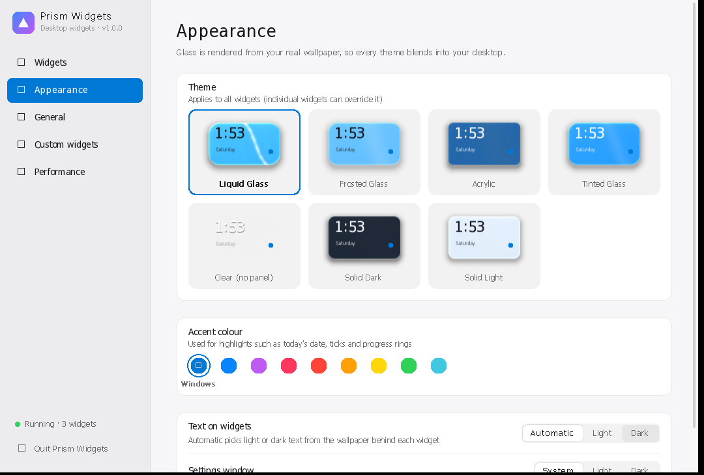

# Prism Widgets

Lightweight desktop widgets for Windows 11. It's native C++ (Win32 + Direct2D), ships as one ~580 KB `.exe`, and needs no installer or runtime.


## Run it

1. Copy `PrismWidgets.exe` anywhere, for example `C:\Apps\PrismWidgets\`.
2. Double-click it. The **Settings** window opens, and your widgets appear on the desktop.
3. Close Settings when you're done. **The widgets keep running in the background**, with a tray icon.
4. To come back to Settings, do any of these:
   * Double-click the `.exe` again.
   * Left-click the tray icon.
   * Right-click a widget and choose **Widget settings…**

When Windows starts it for you (**Start with Windows**), it starts silently with only the widgets and no Settings window.

### Settings window



| Page | What you can do |
|---|---|
| **Widgets** | Live previews of every widget, with a switch to show or hide each one. Click a widget to change its **scale** (slider), reset its **content size**, set its own theme and options (clock style, seconds, 24-hour, week start, hide completed tasks…) or reset its position. |
| **Appearance** | Choose the global theme from previews rendered on your own wallpaper. Also set the accent colour, the text colour on widgets (auto/light/dark) and light or dark mode for the Settings window. |
| **General** | Start with Windows, Arrange widgets, moving widgets without Arrange mode, reset positions, pause during fullscreen games and the data folder |
| **Custom widgets** | Create, edit, enable and reload JSON widgets, with a quick reference |
| **Performance** | Live memory use (the same figure as Task Manager), average CPU, the efficiency status and a *Free memory now* button |

### Arranging widgets

Widgets stay **locked in place** in normal use, so clicking a button or a task never moves them by accident. To move them, open **Arrange mode** in any of these ways:

* the tray menu → **Arrange widgets…**
* right-click a widget → **Arrange widgets…**
* Settings → Widgets → **Arrange on desktop**, or Settings → General
* run `PrismWidgets.exe --arrange`, which works well as a shortcut

In Arrange mode:

| Feature | What it does |
|---|---|
| Edit layer | The screen dims to your wallpaper with a dot grid, and widgets get a frame (the selected one in your accent colour). A dashed line marks the **safe area**. |
| Grid snapping | Widgets snap to an 8-DIP grid, so everything lines up neatly |
| Alignment guides | Accent lines appear when edges or centres line up with another widget or with the middle of the screen |
| Equal spacing | Widgets snap to the standard 16-DIP gap, or to the same gap their neighbours already use. A marker shows the gap. |
| Keyboard | **Arrow keys** move 1 px, and **Shift + arrows** move 10 px. **Tab** selects the next widget. **Esc** or **Enter** finishes. |
| Free placement | Hold **Alt** while dragging to turn snapping off |
| Toolbar | **Auto-arrange** stacks widgets neatly on the right. **Done** saves and locks the layout. |

### Resizing and scaling

In Arrange mode, click a widget to select it. Its handles appear:

| Handle | What it does |
|---|---|
| **Edge pills** (left, right, top, bottom) | **Resize** the widget. The opposite edge stays put and **the layout adapts** to the new shape (see below). The edge snaps to other widgets' edges and to an 8-DIP grid. |
| **Corner dots** | **Scale** the whole widget proportionally, from 60 % to 200 %, in 5 % steps. It also snaps so edges line up with neighbours. |
| **Double-click a handle** | Resets that width or height, or resets the scale to 100 % |

A badge under the widget shows the live size, for example `384 × 350` or `120 %`. Hold **Alt** to resize without snapping. Widgets can never be resized past the screen edge, and neighbours move out of the way when you let go.

On the widget's page in Settings (Widgets → click a widget) there's also a **Scale** slider and the **Content size** with a Reset button.

**How each widget adapts to its size**

| Widget | Small | Default | Large / other shapes |
|---|---|---|---|
| Clock | Time only (the date hides when short) | Time and date | Bigger digits; the full date with the year when wide. Analog stays round. |
| Calendar | "Today" card (weekday, big date, month) | Month grid | Bigger grid, plus **ISO week numbers** when wide |
| To-Do | Fewer rows | 6 rows | More rows when taller, longer text when wider |
| Media Controls | Compact: small art and buttons | Art on the left | **Album card** when tall (big art on top), longer titles when wide |
| System Monitor | List with bars when narrow or tall | Rings in a row | Bigger rings |
| Weather | Temperature and icon | Current conditions and details | Hourly strip (beside or below), then the 7-day list |
| Focus Timer | Smaller ring | Ring with the time and three buttons | Bigger ring |
| Sticky Note | Fewer lines (scroll with the mouse wheel) | About 8 lines | More lines; wider lines |
| World Clocks | One city | One row per city (grows when you add a city) | Up to 8 cities |
| Network Speed | Download and upload stacked | Side by side, with the last minute as a graph | Bigger graph |
| Photo Frame | Any size; the photo is cropped to fill it (or shown whole with **Fit**) | | |
| Custom widgets | Scale only, since their layout is fixed in the JSON file | | |

To drag widgets at any time without Arrange mode, turn on Settings → General → **Move widgets without Arrange mode**.

### Placement rules (always on)

* **Never off-screen.** Widgets can't be dragged even partly off a screen. If one ends up off screen anyway, for example after a resolution change, it's pulled back.
* **Remembers corners, not pixels.** Each widget's position is saved as a monitor, the nearest corner and a distance from it, for example "8 px from the top-right of DISPLAY1". It stays in place when you change resolution or scaling, move the taskbar or dock and undock a laptop. If that monitor is unplugged, the widget moves to the main screen and returns when the monitor is reconnected.
* **No overlaps.** When you drop a widget on another one, or a widget grows (for example, the clock switching to analog), the other widget moves to the nearest free spot.

### On the desktop

| Action | How |
|---|---|
| Quick options | Right-click a widget |
| Add a task | Click **Add a task** on the To-Do widget, type, then press Enter |
| Complete, edit or delete a task | Click the task to complete it. Right-click it to edit or delete. |
| Change the calendar month | Scroll the mouse wheel or click the arrows |
| Quit | Click *Quit Prism Widgets* in Settings, or use the tray menu → Exit |

Command-line flags: `--hidden` starts without opening Settings. `--arrange` opens Arrange mode. `--startup` is used by Start with Windows.

## Weather widget

Shows the **current weather** where you are (temperature, condition, today's high and low, feels-like, humidity and wind), an **hourly** forecast and a **7-day** forecast. The icons are drawn in colour by the app itself.

* **Data:** [Open-Meteo](https://open-meteo.com), a free service that needs no account or API key. Updates every 30 minutes, after the PC wakes from sleep, and when you click **Refresh**.
* **Location:** detected automatically by default. This is approximate, based on your internet connection, from geojs.io with ipwho.is as a fallback. To pick any city instead, use **Change location…** (right-click the widget, or Settings → Weather) and type a name. If there are several places with that name, you choose from a list.
* **Units:** automatic (°F for US region settings, otherwise °C), or set °C / °F yourself.
* **Offline:** the last forecast is kept on disk and shown with "Updated X min ago". Failed updates retry after 5, 10, 15… minutes.
* **Resizing:** the layout adapts:

| Size | Shows |
|---|---|
| Small | Temperature, icon and high/low |
| Default | Current conditions plus feels-like, humidity and wind |
| Wide and short | Current conditions with the hourly forecast beside them |
| Taller | Adds the hourly strip, then the 7-day list with rain chance and temperature-range bars |

* **Light on resources:** nothing runs until a Weather widget is shown. Each update is one small HTTPS request, about 6 KB, on a short-lived background thread. Updates pause during fullscreen games, and the widget only redraws every 5 minutes or when new data arrives.

## Calendar events and holidays

The Calendar widget can show **public holidays**, **your own events** and a **synced Google or Outlook calendar**. Turn it all on or off with **Show events & holidays** (right-click the calendar, or Settings → Calendar). Each source also has its own switch.

* **On the month grid:** days with events get small dots, one per source (red for holidays, your accent colour for your own events, teal for the synced calendar). Holidays also turn the date red.
* **Click any day** to open its details: every event that day, with time and source. From there you can **add an event**, or edit, delete or make yearly one of your own.
  * Type `18:30 Dinner`, `6pm Gym` or just `Mom's birthday`. Events whose name includes "birthday" or "anniversary" repeat yearly automatically.
* **Upcoming:** make the calendar taller (about 420 or more) and a list of the next events appears below the month.
* **Compact size:** shows today's first event instead of the month name. Click it for the day's details.
* **Public holidays:** taken from Google's public holiday calendars for about 50 countries. The country follows your Windows region; use **Holiday region → Change…** to pick another. Updated weekly and cached on disk.
* **Google / Outlook sync (read-only):** paste your calendar's secret iCal (.ics) address into **Sync Google / Outlook calendar → Connect…**.
  * Google Calendar: Settings → *your calendar* → **Secret address in iCal format**.
  * Outlook.com: Settings → Calendar → Shared calendars → **Publish a calendar** → ICS link.
  * Updated every 30 minutes. Recurring events, exceptions and cancelled events are handled. To disconnect, clear the address.
* **Light on resources:** nothing is downloaded until a calendar with events is shown. Updates are one HTTPS request on a short-lived thread, and only the events from 2 months back to 13 months ahead are kept in memory.
* **Reminders:** a small glass card appears in the bottom-right corner before each timed event (your own and the synced calendar), 10 minutes ahead by default. Birthdays and other all-day events of yours get a reminder at 9:00 on the day. Click the card to open that day, or × to close it; it hides by itself after 15 seconds.
  * Settings → Calendar: **Remind me before events** (Off, 5, 10, 15 or 30 min), **Birthdays and all-day events**, **Reminder sound**, and **Preview a reminder**.
  * Holidays never trigger reminders. Reminders wait while a fullscreen game runs or the screen is locked, and missed ones aren't shown later.

## More widgets (v1.9)

Five widgets that are **off by default**. Turn them on in **Settings → Widgets**.

| Widget | What it does |
|---|---|
| **Focus Timer** | Pomodoro-style sessions: click **play** (or the ring) to start a focus session, then take a break. Choose 15–60 minute sessions and 5–15 minute breaks; every fourth break is a long one. When a session or break ends, a small glass card appears in the corner (with an optional chime). The dots show today's sessions. It keeps counting through restarts and sleep. |
| **Sticky Note** | Click the note to write. **Enter** starts a new line; **Ctrl + Enter**, **Esc** or clicking away saves. Pick a paper colour (yellow, pink, mint, blue, lilac) or plain glass, and a text size. Right-click → **Copy text**. |
| **World Clocks** | The time in up to 8 cities, with today/tomorrow and how far ahead or behind you they are, and a sun or moon for day or night. Right-click → **Add a city** (about 50 cities by region); right-click a city to rename, move or remove it. Daylight saving is handled by Windows. |
| **Network Speed** | Live download and upload speed with a one-minute graph. Choose MB/s or Mbps and how often it updates. Only real network adapters are counted, so nothing is counted twice. |
| **Photo Frame** | Show one photo, or a **slideshow** from a folder that changes every minute, 10 minutes, hour or day (or on click), in order or shuffled. Phone photos are turned the right way up. The photo is decoded at the widget's size and then released, so it costs very little memory. |

## Desktop pet

A small robot that lives on your taskbar edge. It types on a laptop while you use a coding tool, scrolls a phone while you browse, paces when bored, sleeps when you lock the PC and gets up to the odd prank. Click it to tickle it, drag it anywhere and it walks home. **Settings → Desktop pet** has its look, behaviour and the apps it reacts to.

* **Light on resources:** 30 fps while it moves; once it has been resting for 20 seconds it drops to 5–8 fps, and to 0 when hidden. It pauses in fullscreen apps and on the lock screen, and optionally on battery (**Pause on battery**).
* **Where it lives:** *On top of windows*, or *Desktop only* (under your windows, with the widgets; Peek lifts it too).
* **Never in the way:** on top of a maximized app it fades and lets clicks through (**Fade over maximized apps**), and holding **Ctrl** over it makes it see-through anytime. Reminder and Focus Timer cards appear above its head.
* **Gentle pranks:** never while you type or during a call (camera or microphone in use). The cursor grab is off unless you turn on **Cursor grab**.
* Layout profiles remember whether the pet is shown.

## Peek at your widgets

Widgets live on the desktop, under your windows. Press **Win + Alt + W** to lift them above everything over a blurred, dimmed backdrop, use them, then press the shortcut again, **Esc**, or click anywhere to put them back.

* Change the shortcut (Win + Alt + W, Ctrl + Alt + W, Ctrl + Shift + Space or Off) in **Settings → General → Peek**. If another app already owns a shortcut, Settings says so.
* Also in the tray menu: **Peek at widgets**.

## Layout profiles

Save the whole setup (which widgets show, where they sit on each screen, their size and theme) as a named layout, such as *Work*, *Gaming* or *Minimal*, and switch between them in one click.

* **Settings → General → Layout profiles:** **Save as new…**, then **Apply**, **Update** (save the current setup over it) or **Delete**.
* **Tray menu → Layouts:** switch layouts without opening Settings.
* Widget options (clock style, weather city, and so on) aren't part of a layout; they stay as they are.

## Updates

Prism Widgets checks for a new version about once a day (Settings → General → Updates → **Check for updates automatically**). When one is out, a notification appears; **Update now** downloads it, checks it, swaps the exe and restarts in about two seconds. Widgets, layouts, to-dos and events are kept.

* Every update is described by `update.json` in this repository and signed with the maintainer's private key. The app only installs a file whose size and SHA-256 match that signed description, so a tampered or corrupted download is refused.
* The folder holding `PrismWidgets.exe` must be writable (anywhere in your user folder is fine). If it isn't, the app says so and you can download the new version from the website.

### Releasing a new version (maintainers)

1. Bump `APP_VERSION` in `src/common.h` (and the version in `res/app.rc` and `res/app.manifest`), then build `PrismWidgets.exe`.
2. Copy the new exe to the repository root.
3. Run `pip install cryptography` once, then `python tools/release.py --version 1.9.1 --notes "What changed"`. This writes `update.json`.
4. Commit and push `PrismWidgets.exe` and `update.json` together. Running copies pick the update up within a day.

The private key lives in `.release/update-signing-key.pem`, which `.gitignore` keeps out of git. Back it up somewhere safe: without it no further update can be signed, and users would have to download new versions by hand.

## Media Controls widget

The Media Controls widget shows **what's playing right now**: the album art, title, artist, which app it's playing in, and a progress bar. It has **previous, play/pause and next** buttons.

* It uses the same media session as the Windows volume flyout, so it works with Spotify, browsers (YouTube, SoundCloud and others), Media Player, VLC, Apple Music and other apps.
* With nothing playing, the buttons send the standard media keys, so pressing play resumes your last player.
* Options: album art and the progress bar can each be turned on or off.
* It checks for changes about once a second while something is playing and every 2 s otherwise. It pauses completely during fullscreen apps and games.
* Album art is decoded once per track at 160 × 160, which takes about 100 KB.

## Themes

| Theme | Look |
|---|---|
| **Liquid Glass** (default) | Clear glass with continuous-curvature ("squircle") corners and a real lens edge: the rounded rim bends the wallpaper the way thick glass does (Snell's law), strongest at the rim and in the corners, with light colour fringing, a bright top-left rim, a soft opposite reflection and gentle bevel shading |
| **Frosted Glass** | Classic glassmorphism: strong blur, white tint and a fine border |
| **Acrylic** | Windows-style dark acrylic with blur, tint and grain |
| **Tinted Glass** | Glass tinted with your accent colour |
| **Clear** | No panel. Text sits directly on the wallpaper with a soft shadow |
| **Solid Dark / Solid Light** | Nearly opaque panels |

**Settings → Appearance → Liquid Glass** fine-tunes that theme: **Clarity** (Clear, Default, Soft, Frosted) and **Edge refraction** (Subtle, Normal, Strong).

The glass is rendered from your actual wallpaper, so the widgets blend into it. Prism Widgets reloads automatically when the wallpaper changes, including slideshow and Spotlight changes. With **Text colour → Automatic**, each widget picks light or dark text based on the wallpaper behind it.

## Why it uses so little RAM (and still feels instant)

* The app is native code with no browser engine, .NET or Electron, and it's statically linked.
* Rendering runs on the CPU only, through a Direct2D software target. This means no GPU driver or VRAM footprint.
* **The glass engine is fast**: the wallpaper is blurred at reduced resolution, the panel interior takes a cheap path, and the edge effects use lookup tables. That's about **7× faster** than v1.5 (41 → 6 ms per redraw on average), with identical output.
* **Dragging moves the finished picture**, so the window just slides at your display's refresh rate. The glass is re-drawn when the mouse rests or when you let go.
* **Resizing redraws at most once per display frame**, and only the newest size.
* **Text layouts are cached**, so unchanged labels are not re-shaped on every redraw. In Arrange mode, the widget contents are kept so frame and position changes only redraw the glass.
* The app redraws only when needed: once a minute for the clock, every 2 s for system stats, and when the media state changes. The media session is checked by its own timer, never while drawing.
* It **pauses completely** during full-screen apps and games, when the screen is off and when the PC is locked.
* **Power mode switches automatically**:
  * When you're using a widget, Settings or Arrange mode, it runs at full speed, so clicks react instantly. Buttons also highlight the moment you press.
  * 3 seconds after you stop, it returns to **efficiency mode** (below-normal priority + Windows EcoQoS).
* **Memory goes back to Windows after 10 idle minutes.** The app doesn't trim itself after every redraw, which used to make the next click slow.
* **Settings → Performance** shows live numbers: memory, CPU, redraw time, click response, drag smoothness and the current power mode.

## Custom widgets

Custom widgets are JSON files in `%APPDATA%\PrismWidgets\widgets\`. To open that folder, use Tray → Widgets → *Open custom widgets folder*. Tray → Widgets → *Create new custom widget…* makes a template and opens it in Notepad. **Saving the file updates the widget instantly.** See `examples/` for four ready-made widgets: Greeting, System Bars, Launcher and Countdown.

```json
{
  "name": "My Widget",
  "width": 260, "height": 110,      // size in DIPs
  "refresh": 1000,                  // ms between redraws (1000 = every second, 0 = static)
  "theme": "frosted",               // optional default theme
  "elements": [
    { "type": "text", "x": 20, "y": 14, "text": "{time:HH:mm:ss}", "size": 34, "weight": "light" },
    { "type": "bar",  "x": 20, "y": 70, "w": 220, "h": 6, "value": "{cpu}", "max": 100, "color": "accent" },
    { "type": "button", "x": 20, "y": 80, "w": 40, "h": 40, "glyph": "E774", "click": "https://example.com" }
  ]
}
```

**Element types**

| Type | Properties |
|---|---|
| `text` | `x y w h text size weight font color align valign wrap` |
| `icon` | `x y w h glyph size color`. `glyph` is a Segoe Fluent Icons hex code point, such as `E713`. |
| `rect` | `x y w h radius fill stroke thickness` |
| `circle` | `x y r fill stroke thickness`. `x` and `y` are the centre. |
| `line` | `x y x2 y2 color thickness` |
| `bar` | `x y w h value max color track radius` |
| `ring` | `x y r thickness value max color track` |
| `button` | `x y w h radius text glyph size fill color click` |
| `image` | `x y w h path`. The path is absolute or relative to the widgets folder. |

* Any element can have `"click"`, which can be a URL, an app, a folder or a `ms-settings:` link.
* Colours are `fg`, `fg2`, `fg3`, `accent`, `onaccent`, `#RRGGBB` or `#RRGGBBAA`.
* Weights are `thin`, `light`, `normal`, `medium`, `semibold`, `bold`, `black` or a number.

**Variables** (usable in `text`, `value` and `click`):

| Variable | Value |
|---|---|
| `{time:HH:mm}` | Time in the given format. Tokens: `HH H hh h mm ss tt`. |
| `{date:dddd, d MMMM}` | Date in the given format. Tokens: `yyyy MMMM MMM MM dddd ddd dd d`. |
| `{greeting}` | Good morning, Good afternoon and so on |
| `{user}` | Your user name |
| `{cpu}` `{ram}` | Usage in % |
| `{ramused}` `{ramtotal}` | Memory in GB |
| `{battery}` `{charging}` | Battery level, and a symbol while charging |
| `{disk:C}` `{diskfree:C}` | Used % and free GB of a drive |
| `{uptime}` | Time since startup |
| `{countdown:2027-01-01}` | Days left until the date |
| `{todo}` | Open tasks |
| `{env:NAME}` | An environment variable |
| `{file:C:\path.txt}` | The first line of a text file |

## Where data is stored

`%APPDATA%\PrismWidgets\` contains `config.json` (widgets, positions and themes), `todo.json`, `events.json` (your calendar events), cached holiday and calendar files (`holidays_XX.ics`, `calendar_sync.ics`) and `widgets\`. Layout profiles, the peek shortcut and update settings are in `config.json` too. To reset everything, delete this folder while the app is closed.

## Build from source

The tested build cross-compiles with MinGW-w64 on Linux or WSL:

```sh
sudo apt install g++-mingw-w64-x86-64-posix
./build.sh            # → build/PrismWidgets.exe
```

On Windows, `CMakeLists.txt` works with MSYS2 MinGW, and should work with Visual Studio, but that build is untested.

Source layout:

| File | Contents |
|---|---|
| `src/app.cpp` | Widget windows, tray, config, scheduling and pausing |
| `src/arrange.cpp` | Arrange mode: the edit layer, grid, guides, spacing, keyboard and toolbar |
| `src/settings.cpp` | The Settings window, custom-drawn with Direct2D and freed when closed |
| `src/glass.cpp` | Wallpaper proxy and the software glass renderer (blur, refraction, rim light, shadow) |
| `src/widgets.cpp` | Clock, Weather, Calendar, To-Do, Media Controls, System Monitor, custom JSON widgets and samples |
| `src/weather.cpp` | Weather service: WinHTTP worker, Open-Meteo forecast, location detection and city search, disk cache |
| `src/events.cpp` | Calendar events: holiday and iCal download, the .ics parser with recurrence rules, your own events |
| `src/daypop.cpp` | The day details popover (add, edit, delete events) |
| `src/net.cpp` | Small asynchronous HTTPS GET helper (WinHTTP) |
| `src/update.cpp` | One-click updates: signed manifest check (ECDSA P-256), download, SHA-256 check, exe swap |
| `src/peek.cpp` | The peek shortcut and its blurred backdrop |
| `src/reminders.cpp` | Event reminders and the corner notification card (also used by the Focus Timer) |
| `src/widgets2.cpp` | Focus Timer, Sticky Note, World Clocks, Network Speed and Photo Frame |
| `tools/release.py` | Signs `update.json` for a release |
| `src/media.cpp` | The Windows media session ("now playing"), accessed through the WinRT interfaces directly |
| `src/util.cpp`, `src/json.cpp` | Helpers, variables and the JSON parser |

## Notes

* Widgets sit on the desktop layer, below every app window. They stay visible after **Win + D**. Desktop icons placed underneath a widget are covered by it.
* Windows 11 only. Icons and fonts use Segoe Fluent Icons and Segoe UI Variable.
* The `.exe` isn't code-signed. If SmartScreen warns, choose *More info → Run anyway*.
