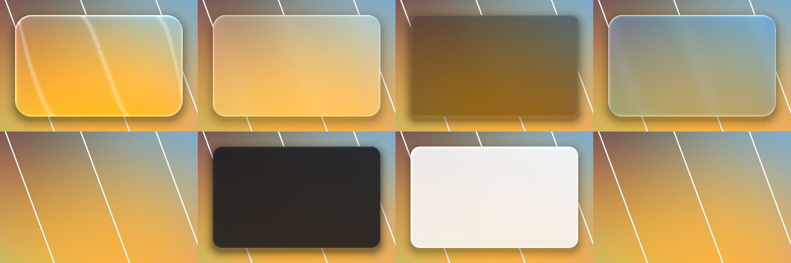

# Prism Widgets

Lightweight desktop widgets for Windows 11. It's native C++ (Win32 + Direct2D), ships as one ~530 KB `.exe`, and needs no installer or runtime.



## Run it

1. Copy `PrismWidgets.exe` anywhere, for example `C:\Apps\PrismWidgets\`.
2. Double-click it. The **Settings** window opens, and your widgets appear on the desktop.
3. Close Settings when you're done. **The widgets keep running in the background**, with a tray icon.
4. To come back to Settings, do any of these:
   * Double-click the `.exe` again.
   * Left-click the tray icon.
   * Right-click a widget and choose **Widget settings…**

When Windows starts it for you (**Start with Windows**), it starts silently with only the widgets and no Settings window.

### Settings window


| Page | What you can do |
|---|---|
| **Widgets** | Live previews of every widget, with a switch to show or hide each one. Click a widget to change its **scale** (slider), reset its **content size**, set its own theme and options (clock style, seconds, 24-hour, week start, hide completed tasks…) or reset its position. |
| **Appearance** | Choose the global theme from previews rendered on your own wallpaper. Also set the accent colour, the text colour on widgets (auto/light/dark) and light or dark mode for the Settings window. |
| **General** | Start with Windows, Arrange widgets, moving widgets without Arrange mode, reset positions, pause during fullscreen games and the data folder |
| **Custom widgets** | Create, edit, enable and reload JSON widgets, with a quick reference |
| **Performance** | Live memory use (the same figure as Task Manager), average CPU, the efficiency status and a *Free memory now* button |

### Arranging widgets

Widgets stay **locked in place** in normal use, so clicking a button or a task never moves them by accident. To move them, open **Arrange mode** in any of these ways:

* the tray menu → **Arrange widgets…**
* right-click a widget → **Arrange widgets…**
* Settings → Widgets → **Arrange on desktop**, or Settings → General
* run `PrismWidgets.exe --arrange`, which works well as a shortcut

In Arrange mode:

| Feature | What it does |
|---|---|
| Edit layer | The screen dims to your wallpaper with a dot grid, and widgets get a frame (the selected one in your accent colour). A dashed line marks the **safe area**. |
| Grid snapping | Widgets snap to an 8-DIP grid, so everything lines up neatly |
| Alignment guides | Accent lines appear when edges or centres line up with another widget or with the middle of the screen |
| Equal spacing | Widgets snap to the standard 16-DIP gap, or to the same gap their neighbours already use. A marker shows the gap. |
| Keyboard | **Arrow keys** move 1 px, and **Shift + arrows** move 10 px. **Tab** selects the next widget. **Esc** or **Enter** finishes. |
| Free placement | Hold **Alt** while dragging to turn snapping off |
| Toolbar | **Auto-arrange** stacks widgets neatly on the right. **Done** saves and locks the layout. |

### Resizing and scaling

In Arrange mode, click a widget to select it. Its handles appear:

| Handle | What it does |
|---|---|
| **Edge pills** (left, right, top, bottom) | **Resize** the widget. The opposite edge stays put and **the layout adapts** to the new shape (see below). The edge snaps to other widgets' edges and to an 8-DIP grid. |
| **Corner dots** | **Scale** the whole widget proportionally, from 60 % to 200 %, in 5 % steps. It also snaps so edges line up with neighbours. |
| **Double-click a handle** | Resets that width or height, or resets the scale to 100 % |

A badge under the widget shows the live size, for example `384 × 350` or `120 %`. Hold **Alt** to resize without snapping. Widgets can never be resized past the screen edge, and neighbours move out of the way when you let go.

On the widget's page in Settings (Widgets → click a widget) there's also a **Scale** slider and the **Content size** with a Reset button.

**How each widget adapts to its size**

| Widget | Small | Default | Large / other shapes |
|---|---|---|---|
| Clock | Time only (the date hides when short) | Time and date | Bigger digits; the full date with the year when wide. Analog stays round. |
| Calendar | "Today" card (weekday, big date, month) | Month grid | Bigger grid, plus **ISO week numbers** when wide |
| To-Do | Fewer rows | 6 rows | More rows when taller, longer text when wider |
| Media Controls | Compact: small art and buttons | Art on the left | **Album card** when tall (big art on top), longer titles when wide |
| System Monitor | List with bars when narrow or tall | Rings in a row | Bigger rings |
| Custom widgets | Scale only, since their layout is fixed in the JSON file | | |

To drag widgets at any time without Arrange mode, turn on Settings → General → **Move widgets without Arrange mode**.

### Placement rules (always on)

* **Never off-screen.** Widgets can't be dragged even partly off a screen. If one ends up off screen anyway, for example after a resolution change, it's pulled back.
* **Remembers corners, not pixels.** Each widget's position is saved as a monitor, the nearest corner and a distance from it, for example "8 px from the top-right of DISPLAY1". It stays in place when you change resolution or scaling, move the taskbar or dock and undock a laptop. If that monitor is unplugged, the widget moves to the main screen and returns when the monitor is reconnected.
* **No overlaps.** When you drop a widget on another one, or a widget grows (for example, the clock switching to analog), the other widget moves to the nearest free spot.

### On the desktop

| Action | How |
|---|---|
| Quick options | Right-click a widget |
| Add a task | Click **Add a task** on the To-Do widget, type, then press Enter |
| Complete, edit or delete a task | Click the task to complete it. Right-click it to edit or delete. |
| Change the calendar month | Scroll the mouse wheel or click the arrows |
| Quit | Click *Quit Prism Widgets* in Settings, or use the tray menu → Exit |

Command-line flags: `--hidden` starts without opening Settings. `--arrange` opens Arrange mode. `--startup` is used by Start with Windows.

## Media Controls widget

The Media Controls widget shows **what's playing right now**: the album art, title, artist, which app it's playing in, and a progress bar. It has **previous, play/pause and next** buttons.

* It uses the same media session as the Windows volume flyout, so it works with Spotify, browsers (YouTube, SoundCloud and others), Media Player, VLC, Apple Music and other apps.
* With nothing playing, the buttons send the standard media keys, so pressing play resumes your last player.
* Options: album art and the progress bar can each be turned on or off.
* It checks for changes about once a second while something is playing and every 2 s otherwise. It pauses completely during fullscreen apps and games.
* Album art is decoded once per track at 160 × 160, which takes about 100 KB.

## Themes

| Theme | Look |
|---|---|
| **Liquid Glass** (default) | Clear glass with lens refraction at the edges, light chromatic fringing and specular rim highlights |
| **Frosted Glass** | Classic glassmorphism: strong blur, white tint and a fine border |
| **Acrylic** | Windows-style dark acrylic with blur, tint and grain |
| **Tinted Glass** | Glass tinted with your accent colour |
| **Clear** | No panel. Text sits directly on the wallpaper with a soft shadow |
| **Solid Dark / Solid Light** | Nearly opaque panels |

The glass is rendered from your actual wallpaper, so the widgets blend into it. Prism Widgets reloads automatically when the wallpaper changes, including slideshow and Spotlight changes. With **Text colour → Automatic**, each widget picks light or dark text based on the wallpaper behind it.

## Why it uses so little RAM

* The app is native code with no browser engine, .NET or Electron, and it's statically linked.
* Rendering runs on the CPU only, through a Direct2D software target. This means no GPU driver or VRAM footprint.
* The wallpaper is decoded once into a small proxy. Each widget keeps only its own blurred crop, and the proxy is freed after 8 s of idle time.
* Frame buffers are freed right after they're handed to Windows (DWM).
* The Settings window and its previews exist only while the window is open. They are released when you close it.
* The app redraws only when needed: once a minute for the clock (once a second if seconds are shown) and every 2 s for system stats. Nothing runs between updates.
* It **pauses completely** during full-screen apps and games, when the screen is off and when the PC is locked.
* The process runs at below-normal priority with EcoQoS (efficiency mode) and low memory priority, and it trims its working set when idle.

The expected footprint is about **5–15 MB** in Task Manager with the default three widgets.

## Custom widgets

Custom widgets are JSON files in `%APPDATA%\PrismWidgets\widgets\`. To open that folder, use Tray → Widgets → *Open custom widgets folder*. Tray → Widgets → *Create new custom widget…* makes a template and opens it in Notepad. **Saving the file updates the widget instantly.** See `examples/` for four ready-made widgets: Greeting, System Bars, Launcher and Countdown.

```json
{
  "name": "My Widget",
  "width": 260, "height": 110,      // size in DIPs
  "refresh": 1000,                  // ms between redraws (1000 = every second, 0 = static)
  "theme": "frosted",               // optional default theme
  "elements": [
    { "type": "text", "x": 20, "y": 14, "text": "{time:HH:mm:ss}", "size": 34, "weight": "light" },
    { "type": "bar",  "x": 20, "y": 70, "w": 220, "h": 6, "value": "{cpu}", "max": 100, "color": "accent" },
    { "type": "button", "x": 20, "y": 80, "w": 40, "h": 40, "glyph": "E774", "click": "https://example.com" }
  ]
}
```

**Element types**

| Type | Properties |
|---|---|
| `text` | `x y w h text size weight font color align valign wrap` |
| `icon` | `x y w h glyph size color`. `glyph` is a Segoe Fluent Icons hex code point, such as `E713`. |
| `rect` | `x y w h radius fill stroke thickness` |
| `circle` | `x y r fill stroke thickness`. `x` and `y` are the centre. |
| `line` | `x y x2 y2 color thickness` |
| `bar` | `x y w h value max color track radius` |
| `ring` | `x y r thickness value max color track` |
| `button` | `x y w h radius text glyph size fill color click` |
| `image` | `x y w h path`. The path is absolute or relative to the widgets folder. |

* Any element can have `"click"`, which can be a URL, an app, a folder or a `ms-settings:` link.
* Colours are `fg`, `fg2`, `fg3`, `accent`, `onaccent`, `#RRGGBB` or `#RRGGBBAA`.
* Weights are `thin`, `light`, `normal`, `medium`, `semibold`, `bold`, `black` or a number.

**Variables** (usable in `text`, `value` and `click`):

| Variable | Value |
|---|---|
| `{time:HH:mm}` | Time in the given format. Tokens: `HH H hh h mm ss tt`. |
| `{date:dddd, d MMMM}` | Date in the given format. Tokens: `yyyy MMMM MMM MM dddd ddd dd d`. |
| `{greeting}` | Good morning, Good afternoon and so on |
| `{user}` | Your user name |
| `{cpu}` `{ram}` | Usage in % |
| `{ramused}` `{ramtotal}` | Memory in GB |
| `{battery}` `{charging}` | Battery level, and a symbol while charging |
| `{disk:C}` `{diskfree:C}` | Used % and free GB of a drive |
| `{uptime}` | Time since startup |
| `{countdown:2027-01-01}` | Days left until the date |
| `{todo}` | Open tasks |
| `{env:NAME}` | An environment variable |
| `{file:C:\path.txt}` | The first line of a text file |

## Where data is stored

`%APPDATA%\PrismWidgets\` contains `config.json` (widgets, positions and themes), `todo.json` and `widgets\`. To reset everything, delete this folder while the app is closed.

## Build from source

The tested build cross-compiles with MinGW-w64 on Linux or WSL:

```sh
sudo apt install g++-mingw-w64-x86-64-posix
./build.sh            # → build/PrismWidgets.exe
```

On Windows, `CMakeLists.txt` works with MSYS2 MinGW, and should work with Visual Studio, but that build is untested.

Source layout:

| File | Contents |
|---|---|
| `src/app.cpp` | Widget windows, tray, config, scheduling and pausing |
| `src/arrange.cpp` | Arrange mode: the edit layer, grid, guides, spacing, keyboard and toolbar |
| `src/settings.cpp` | The Settings window, custom-drawn with Direct2D and freed when closed |
| `src/glass.cpp` | Wallpaper proxy and the software glass renderer (blur, refraction, rim light, shadow) |
| `src/widgets.cpp` | Clock, Calendar, To-Do, Media Controls, System Monitor, custom JSON widgets and samples |
| `src/media.cpp` | The Windows media session ("now playing"), accessed through the WinRT interfaces directly |
| `src/util.cpp`, `src/json.cpp` | Helpers, variables and the JSON parser |

## Notes

* Widgets sit on the desktop layer, below every app window. They stay visible after **Win + D**. Desktop icons placed underneath a widget are covered by it.
* Windows 11 only. Icons and fonts use Segoe Fluent Icons and Segoe UI Variable.
* The `.exe` isn't code-signed. If SmartScreen warns, choose *More info → Run anyway*.
